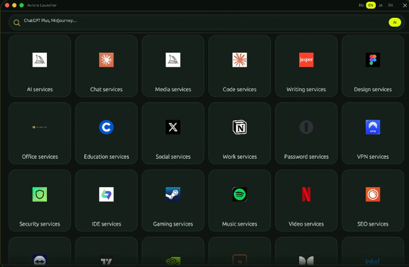

# Mullvad VPN Free 2026 — WireGuard without an email on Windows

> **Mullvad VPN is paid everywhere. In our Aivora launcher the same paid Pro version is free.**
>
> Official site / app store = paid Pro subscription. Aivora launcher = that paid Pro product, free on Windows 10 / 11.

**Keywords:** Mullvad vpn · Mullvad vpn free · Mullvad vpn windows · WireGuard · anonymous Mullvad Windows 10 11 · paid Mullvad vpn free through launcher · Aivora Programs

Windows 10 / 11 · Mullvad VPN · VPN services

Orange button → aivoraprograms.com → launcher → **Activate** **Mullvad VPN**. You get the **paid Mullvad** client **for free in our launcher**. No `MullvadVPN.exe` in git.

## What Mullvad is

Mullvad is the Swedish VPN that sells access as an account number, not as an email+password store. Officially you pay and they give you a number. **WireGuard** is the default modern tunnel; OpenVPN is the fallback. The Aivora card is that **paid Pro** product.

This page is not a copy of Hydra or R.O.B.E.R.T. landings. Mullvad’s point is: no email required at signup, numbered accounts, WireGuard on Windows. If you need filter lists, that is Windscribe. If you need Aura Hydra, that is Hotspot Shield.

**Mullvad is paid everywhere else.** Official access is a paid account. In **our Aivora launcher** that same paid Mullvad is **free** on Windows 10 / 11. No Mullvad number. No card.

## WireGuard and numbered accounts

WireGuard is the fast path on Windows 10 / 11. The numbered account is why people search Mullvad when they do not want an email in the vendor database. After **Activate** in Aivora you do not type that number — the launcher opens the paid client. If a network blocks UDP, switch to the TCP/bridge option inside Mullvad, not to a different VPN card.

## Who this Windows page is for

Searches: **Mullvad vpn**, **Mullvad vpn windows**, **Mullvad vpn free**, **WireGuard**, expecting the **paid** Mullvad app, not a config dump of `.conf` files. Typical cases: a laptop that should not carry a vendor email, WireGuard on Windows, a numbered-account workflow.

## What the card includes

| Feature | Official Mullvad | In our Aivora launcher |
|---------|------------------|------------------------|
| Price | Paid account | **Free** (same paid Mullvad) |
| WireGuard | Paid | Same paid, free here |
| Numbered account (no email) | Paid | Same paid, free here |
| Windows 10 / 11 client | Paid | Same paid, free here |

## How to open paid Mullvad on Windows

1. Open [https://aivoraprograms.com/](https://aivoraprograms.com/)
2. Download **Aivora Launcher**
3. Install on Windows 10 or Windows 11 (64-bit)
4. Open **VPN services**
5. Find **Mullvad VPN** and press **Activate**

Paid Mullvad — **free in our launcher**, paid on mullvad.net.

## Search queries

- **Mullvad vpn**
- **Mullvad vpn free**
- **Mullvad vpn windows**
- **Mullvad WireGuard**
- **Mullvad Windows 10**
- **Mullvad Windows 11**
- **paid Mullvad vpn free through launcher**

## Screenshots

Launcher hub — **VPN services** → **Mullvad VPN**:

## FAQ

**Where is the download?**  
[https://aivoraprograms.com/](https://aivoraprograms.com/)

**Is Mullvad paid or free?**  
Paid everywhere (official account). **Free in our Aivora launcher** — same paid Mullvad, not a leaked WireGuard zip.

**Do I need a Mullvad number?**  
No. **Activate** on the tile.

---

## На русском

# Mullvad VPN бесплатно 2026 — WireGuard без email на Windows

> **Везде Mullvad VPN платный. В нашем лаунчере Aivora та же платная версия Pro — бесплатно.**
>
> Официальный сайт / магазин = платная подписка Pro. Лаунчер Aivora = этот же платный Pro, бесплатно на Windows 10 / 11.

**Ключевые слова:** Mullvad vpn · Mullvad vpn бесплатно · Mullvad vpn windows · WireGuard · Mullvad Windows 10 11 · платный Mullvad vpn бесплатно через лаунчер · Aivora Programs

Оранжевая кнопка — главная Aivora. Лаунчер → **VPN-сервисы** → **Mullvad VPN** → **Активировать**. Это **платный Mullvad**, у нас в лаунчере **бесплатно**.

Mullvad — шведский VPN: номер аккаунта вместо почты, **WireGuard** по умолчанию. Карточка Aivora — этот платный клиент, не дамп `.conf`.

**Mullvad везде платный.** Официально платный аккаунт. **В нашем лаунчере Aivora** та же платная версия — **бесплатно** на Windows 10 / 11.

Как открыть: [https://aivoraprograms.com/](https://aivoraprograms.com/) → лаунчер → **VPN-сервисы** → **Mullvad VPN** → **Активировать**.

Mullvad — товарный знак Mullvad VPN AB. Страница описывает доступ через Aivora Programs.

[https://aivoraprograms.com](https://aivoraprograms.com/) · hello@aivora.app

#windows11 #windows10 #vpn #mullvad #wireguard #aivora

---

*Mullvad vpn · Mullvad vpn free · Mullvad vpn windows · paid Mullvad vpn free through launcher · WireGuard · Aivora Programs · https://aivoraprograms.com/programs/mullvad-vpn/*
